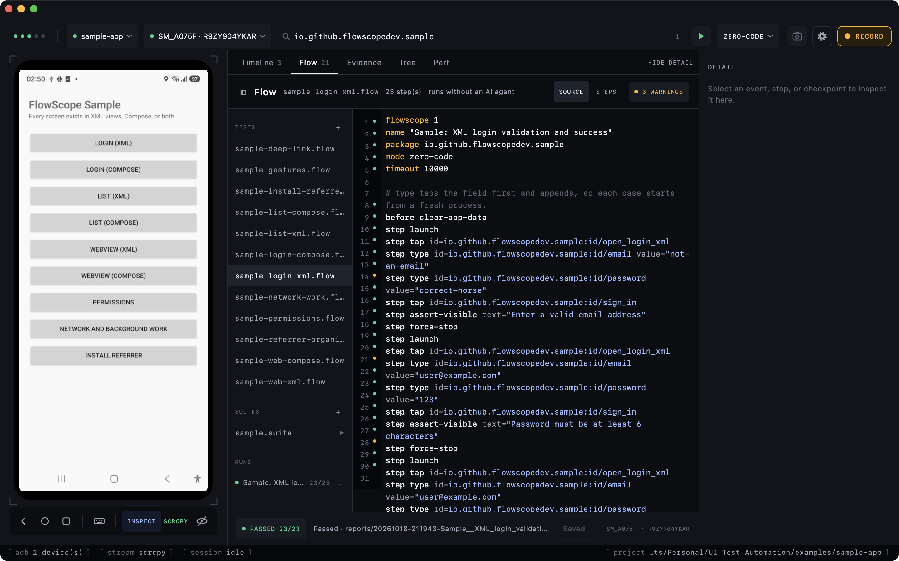
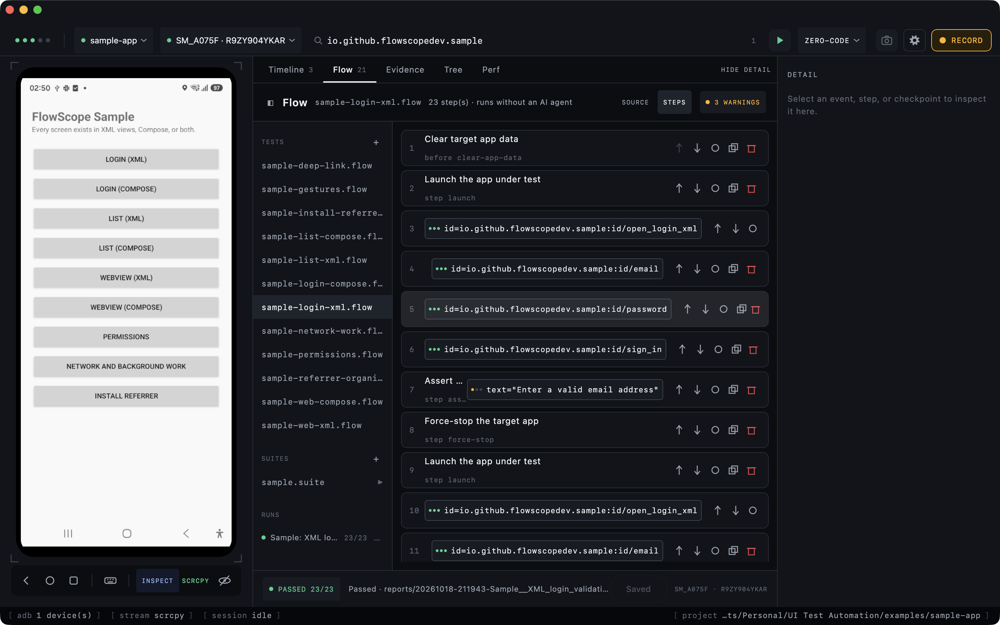

# FlowScope

[](https://github.com/FlowScopeDev/flowscope/actions/workflows/ci.yml)
[](https://github.com/FlowScopeDev/flowscope/actions/workflows/sample-suite-emulator.yml)

FlowScope is a macOS and Windows desktop recorder plus CLI for observing Android UI flows and
replaying durable tests. It supports physical devices and emulators over USB or wireless ADB.



The live device sits beside the test it drives. The rail lists the project's tests, suites and past
runs; the green play button saves the open `.flow` and replays it on the selected device, with the
result reported against the file you can read.

## Two capture modes

| Mode | App changes | Captures |
|---|---|---|
| **Zero-code** | None; APK must be debuggable | Screenshots, UIAutomator hierarchy, window state, filtered Logcat, and best-effort accessibility events. |
| **Instrumented** | Optional debug-only agent | Everything above plus exact touch/scroll coordinates, component metadata, lifecycle/semantic events, and extension points for API and background-work events. |

Zero-code is broadly compatible but lower fidelity, especially for Compose nodes with merged or
missing semantics. Instrumented mode is intended for development builds; release variants must not
emit agent events.

## Run the IDE

```bash
./gradlew :recorder-ide:run
```

Choose a connected device, enter an application ID, select **Zero-code** or **Instrumented**, and
start recording. The device screen remains live while checkpoints capture a screenshot, hierarchy,
and window state. The green play button beside the application ID saves the open file and runs it
on the selected device; it is disabled until there is a device and the file parses, and its hover
hint says which of the two is missing.

For low-latency interaction, install [scrcpy](https://github.com/Genymobile/scrcpy) and FFmpeg.
FlowScope automatically starts the matching `scrcpy-server`, decodes its H.264 stream, and renders it
inside the Live Device component. Clicks, drags, mouse-wheel scrolling, safe text/host-clipboard
input, and Back/Home/App Switch controls are sent to the device. **Open
external mirror** remains available as a troubleshooting fallback, while ADB screenshots remain the
evidence/fallback feed if embedded streaming is unavailable.

FlowScope drives scrcpy's control socket for input, so **scrcpy 4.x is required for low-latency
interaction**. Older versions still stream video; input falls back to `adb shell input`, which is
noticeably slower and cannot express a held drag. `flowscope doctor` reports which path is active.

```bash
# macOS
brew install scrcpy
brew install ffmpeg

# Verify what FlowScope found
flowscope doctor
```

On Windows, install an official scrcpy release plus FFmpeg and put `scrcpy.exe` and `ffmpeg.exe` on
`PATH`. On either platform, `SCRCPY`, `SCRCPY_SERVER_PATH`, and `FFMPEG` may point to explicit files.
scrcpy requires no APK-side integration and works in both FlowScope capture modes.

The desktop workspace is functional end to end:

- **Live recorder** streams zero-code accessibility/log events or instrumented UI/API/service events.
- **Test steps** edits, validates, saves, and runs the generated `.flow` test on the selected device.
- **Evidence** browses checkpoint screenshots and opens the session folder.
- **Component tree** renders the latest captured UIAutomator hierarchy.
- **Performance** collects package-scoped `dumpsys meminfo` and `gfxinfo` output.
- **Settings** opens from the gear immediately left of Record in the session bar. Appearance can follow the
  operating system or be pinned to Light or Dark; the choice is applied immediately and saved in
  `~/.flowscope/theme.txt`. **Show device display** (also in the command palette) can be turned off to stop the
  scrcpy/FFmpeg stream and screenshot polling and save CPU; recording, the Tree and test runs keep working
  through ADB. The choice is saved in `~/.flowscope/show-device.txt`.
- **Run notifications** use the operating system notification center when an IDE-started test or
  regression finishes. Test notifications identify the test result; regression notifications include
  passed, failed, and skipped totals. CLI and CI runs remain silent.

Desktop recording sessions are stored under `~/.flowscope/`. Replay reports go to the open project's
`reports/`, or to `~/.flowscope/test-runs/` when no project is open. CLI output continues to use the
explicit `--output` directory, falling back to the project's `reports/` and then to its documented
working-directory default.

On macOS, `run-flowscope.command` launches the development build. A Finder-distributed `.app` still
requires Developer ID signing and notarization. Local `createDistributable` builds are stripped of
inherited quarantine/provenance metadata and ad-hoc signed so Finder can open them on the build Mac.
Compose Desktop produces Windows packages from a Windows host and macOS packages from a Mac host.

## Install the desktop app

On macOS, install via Homebrew:

```bash
brew tap FlowScopeDev/homebrew-tap
brew install --cask flowscope
```

FlowScope isn't signed with an Apple Developer ID (it's a one-person project; a certificate costs
money every year), so a DMG downloaded directly from a release still trips Gatekeeper's "damaged"
dialog. Homebrew clears the quarantine attribute it applies to files it downloads, so installing
through the cask avoids that dialog entirely. Downloading the DMG directly from a GitHub release
instead still works, but needs the manual workaround described in the release notes
(`xattr -cr "/Applications/Flow Scope.app"`, or right-click the app and choose Open).

## Install the CLI

```bash
./gradlew :recorder-host:installDist
export PATH="$PWD/recorder-host/build/install/flowscope/bin:$PATH"
```

The installed executable is named `flowscope`.

```bash
flowscope doctor
flowscope devices
flowscope emulators
flowscope emulator start <avd> [--headless] [--wait] [--timeout <ms>]
flowscope emulator stop <serial>
flowscope mirror --serial <adb-serial>
flowscope mirror --serial <adb-serial> --read-only
flowscope record --package com.example.debug --mode zero-code
flowscope record --package com.example.debug --mode instrumented
flowscope snapshot --package com.example.debug --mode zero-code
flowscope web inspect --package com.example.debug --format json
```

Use `--serial <adb-serial>` whenever more than one device is connected. Recording is interactive:
Enter creates a checkpoint and `q` stops. `snapshot` is non-interactive and is preferable for coding
agents collecting current device evidence.

## Integrating the instrumented agent

Instrumented mode needs the debug-only Android agent in the app under test. It ships as a Maven
library (`android-agent/`, a standalone Gradle build so the host and IDE need no Android SDK):

```kotlin
// Resolved from Maven Central; for an unreleased build add mavenLocal() to repositories.
debugImplementation("io.github.flowscopedev:flowscope-agent:0.1.0")
releaseImplementation("io.github.flowscopedev:flowscope-agent-no-op:0.1.0")
```

`flowscope-agent` installs itself through a `ContentProvider`: lifecycle and touch events need no app code.
`flowscope-agent-no-op` has the same API (`FlowScopeAgent.onSemanticAction`, `onNetwork`, `onBackgroundWork`)
with empty bodies and no manifest entries, so release builds contain no capture code. The agent
emits an `agent.hello` event carrying its version when it starts. Build a local copy with:

```bash
cd android-agent && ANDROID_HOME=$HOME/Library/Android/sdk ./gradlew publishToMavenLocal
```

Releases go to Maven Central: bump `VERSION_NAME` in `android-agent/gradle.properties`, then push the
tag `agent-v<version>`. The workflow stages the deployment; release it from the Central Portal.

The agent is versioned on its own (`VERSION_NAME`, currently `0.1.0`). The CLI builds as a
`-SNAPSHOT` and the packaged IDE app carries its own version (`packageVersion` in
`recorder-ide/build.gradle.kts`; macOS packaging requires a major version of at least 1), so the
three numbers need not match.

`examples/sample-app/` is a complete client app that consumes the published artifacts and exercises each
feature in both XML views and Compose; its flows run with `flowscope suite run flows/suites/sample.suite
--project examples`.

For authoritative WebView bridge and settings metadata, use the API-compatible wrappers in debug
and release code:

```kotlin
FlowScopeAgent.addJavascriptInterface(webView, paymentsBridge, "Payments")
FlowScopeAgent.observeWebView(webView, "checkout")
// When removing it:
FlowScopeAgent.removeJavascriptInterface(webView, "Payments")
```

Both artifacts delegate to the platform WebView API. The debug artifact records only the bridge
name, methods annotated with `@JavascriptInterface`, and safe WebView settings. It never records
bridge arguments, return values, object fields, page content, or cookie/storage values.

## Write once, run later—without an AI agent

Tests are plain `.flow` files interpreted by the Java runner. Claude, Codex, another coding agent, or
a developer can author the file; later runs need only FlowScope, ADB, the APK, and a device.

```text
flowscope 1
name "Login smoke test"
package com.example.debug
mode zero-code
timeout 10000

before clear-app-data
step launch
step tap-if-visible text="Dismiss" timeout=3000
step wait-visible id=com.example.debug:id/sign_in
step tap id=com.example.debug:id/sign_in
step tap text-contains="Terms & Policies"
step assert-visible text="Welcome" timeout=30000
step screenshot name=welcome
after screenshot name=final-state
after force-stop
```

```bash
flowscope schema
flowscope test validate tests/login.flow
flowscope test run tests/login.flow --serial <adb-serial>
```

`before` prepares and verifies the initial state, `step` is the test body, and `after` always runs
cleanup even when setup or the test fails. Replay uses selector conditions and UI stability checks
rather than recorded delays. Every run writes `report.json`, an offline `report.html`, and
`junit.xml`; failures also save a screenshot and UI hierarchy.

Each of the three phases is reported distinctly, because a leaked fixture and a failed assertion
need different fixes. `report.json` separates `primaryFailure` (setup or test) from
`teardownFailures`; `report.html` gives cleanup its own **Cleanup failures** heading; `junit.xml`
names the phase in the failure message and lists every cleanup failure in the failure body; and the
CLI prints one `FAILED: …` line naming the phase. A failed cleanup still fails the run (exit `1`) —
a dirty device or an undeleted fixture would poison the next one. Every report includes a
**Performance** section (total time, UI hierarchy dumps and their share of the run, slowest steps),
and `instrumented` runs add an **Agent events** section: the app's own semantic actions, network
calls (route templates and status only), and background work, each attributed to the step during which
it arrived. Event bodies, headers, and arguments are never captured.

Host-side API setup and cleanup can use environment variables without checking secrets into Git:

```text
before api-request method=GET url="${env.API_BASE_URL}/health" \
  expect-status=200 expect-json.status=UP timeout=30000 retry-interval=1000
before api-request method=POST url="${env.API_BASE_URL}/fixtures" \
  header.Authorization="Bearer ${env.API_TOKEN}" body='{"kind":"smoke"}' \
  expect-status=201 capture.fixtureId=data.id
step launch
after api-request method=DELETE url="${env.API_BASE_URL}/fixtures/${var.fixtureId}" \
  expect-status=200,204,404 if-var=fixtureId
```

Gestures and input beyond `tap` and `scroll`. `direction=` is where the finger moves, as for `scroll`:

```text
step scroll-to text="Order total" max-swipes=8        # swipes until visible; stops at the end of the content
step long-press id=com.example.debug:id/row duration=900
step swipe direction=left id=com.example.debug:id/carousel distance=60
step clear-text id=com.example.debug:id/email
step press-key key=enter                              # enter, search, delete, tab, home, app-switch, volume-up/down
step hide-keyboard                                    # Back only while the keyboard is showing
step assert-visible id=com.example.debug:id/accept checked=true index=1
```

Any selector can add `index=N` (zero-based nth match) and the state filters `enabled=`, `checked=`,
`focused=`, `clickable=`, and `selected=` (`true` or `false`); they narrow a selector and never select
on their own. `double-tap` is deliberately absent: `adb` cannot deliver two taps inside Android's
300 ms double-tap window reliably.

Target-app actions include `clear-app-data`, `force-stop`, `grant-permission`,
`revoke-permission`, and app-scoped `reset-app-permissions`. FlowScope never uses Android's
device-wide permission reset and never stores environment values, API bodies, or captured values in
reports.

### Deep links

Deep links are launched directly into the declared package, avoiding Android's resolver and other
installed handlers. When more than one activity in that package handles the URI, add `activity=` to
choose explicitly; FlowScope fails instead of opening an ambiguous resolver. Query values are
redacted from reports.

```text
before force-stop
step assert-deep-link-handler uri="myapp://customer/${env.TEST_CUSTOMER_ID}"
step open-deep-link uri="myapp://customer/${env.TEST_CUSTOMER_ID}" cold-start=true
step assert-visible text="Customer details"
step assert-app-link-verified host=example.com
```

`assert-app-link-verified` uses Android's package-manager verification state and reports when the
connected Android version cannot expose it.

### Install and upgrade journeys

FlowScope can deterministically test package-manager installation without automating Play Store UI.
APK paths are relative to the `.flow` file and are preflighted with Android SDK `apkanalyzer`; an APK
whose application ID differs from the test's `package` is rejected before ADB changes the device.

```text
before uninstall-app keep-data=false
before install-apk file="artifacts/app-v119.apk"
step launch
step install-apk file="artifacts/app-v120.apk" replace=true
step assert-installed version-code=120 version-name=1.2.0
step launch
step assert-visible text="Existing account"
```

Supported install flags are `replace`, `downgrade`, `grant-permissions`, and `test-only`. Reports
retain the APK filename, SHA-256 fingerprint, and installed version—not the APK itself. A genuine
Play Store test remains an external environment test requiring a signed build, Play-enabled device,
test account, network, and test-track or internal-app-sharing URL. FlowScope does not impersonate
Play Store billing, licensing, asset delivery, or Install Referrer services.

Instrumented debug builds can opt into deterministic campaign/referrer setup:

```text
before set-install-referrer value="utm_source=flowscope&utm_campaign=smoke"
step launch
after clear-install-referrer
```

In the app's debug referrer abstraction, consult
`FlowScopeAgent.installReferrerOverride(context)` before calling the normal Play Install Referrer
client. The release `agent-noop` twin always returns `null`. FlowScope stores the injected value only
inside the target app sandbox and excludes it from reports; this hook does not impersonate the
signed Play Store service.

### WebViews

Existing native selectors continue to work when a WebView exposes accessibility nodes. When it is
opaque, FlowScope explains that DOM actions are required. The `web-*` actions connect only to the
declared package's debuggable WebView through its Chrome DevTools socket:

```text
step web-wait css="form#checkout" timeout=20000
step web-type css="input[name=email]" value="${env.TEST_EMAIL}"
step web-tap css="button[type=submit]"
step web-assert-url path="/checkout/success"
step web-assert-text css="h1" text="Payment complete"
step web-screenshot name=checkout-complete
step web-assert-cookie name=session_id domain=.example.com path=/ \
  secure=true http-only=true same-site=Lax
step web-assert-storage area=local key=customerId exists=true
step web-assert-interface name=Payments methods="startPayment,getStatus"
step web-assert-secure-context value=true
step web-snapshot name=checkout-web-state
after web-clear-cookies domain=.example.com name=session_id path=/
after web-clear-storage origin="https://example.com" types=local,session,indexeddb,cache
```

Cookie assertions can additionally check `exists`, `session`, and an expected runtime `value` from
`${env.*}` or `${var.*}`. Storage assertions support `local` and `session`. Values are compared only
in memory: the IDE, CLI, JSON/HTML/JUnit reports, evidence, and failures show names, scope, flags,
sizes, and counts but never values. Cookie clearing requires a domain and storage clearing requires
an origin plus allowlisted storage types, so a test cannot accidentally clear an entire browser
profile.

Use `page=` to choose a page or out-of-process iframe by target id, sanitized URL, or title substring
when more than one debug target exists. The IDE exposes the same targets under **Tree → WebView**,
with Cookies, Storage, Native Bridges, Frames, and Security sections. Runtime bridge discovery in
zero-code mode is labelled heuristic; bridges registered through the agent wrapper are labelled
exact. FlowScope exposes only restricted operations—tests cannot supply raw JavaScript or arbitrary
DevTools commands. Reports strip query values and do not persist cookie values, storage values, headers,
response bodies, page titles, or DOM dumps.

For a deterministic device smoke test, build and install the included fixture:

```bash
cd android-agent
./gradlew :webview-fixture:installDebug
adb shell am start -n dev.flowscope.fixture/.MainActivity
../recorder-host/build/install/flowscope/bin/flowscope web inspect \
  --package dev.flowscope.fixture --mode instrumented --format json
```

## Projects

Tests and suites are organised into projects, one per application. A project is an ordinary directory
marked by `flowscope.json`, so it lives in the app's own repository next to the code it tests.

```bash
flowscope project init . --name "Example app" --package com.example.debug
```

```text
my-app/
  flowscope.json          # project marker and configuration
  flows/
    tests/*.flow          # test cases
    suites/*.suite        # regression suites
  reports/                # run output, gitignored by `project init`
```

Inside a project, a bare test name resolves and runs land in `reports/`:

```bash
flowscope project info
flowscope project tests
flowscope test run login --serial <adb-serial>      # resolves flows/tests/login.flow
flowscope project validate                          # parses every test and suite — the CI check
```

A suite is an ordered list of tests, in the same line-oriented idiom as `.flow`:

```text
flowscope-suite 1
name "Nightly regression"
continue-on-failure true

test tests/login.flow
test tests/terms.flow
```

```bash
flowscope suite validate flows/suites/nightly.suite
flowscope suite run --serial <adb-serial>           # uses "suite" from flowscope.json
```

A suite run writes `suite-report.json`, `suite-report.html`, and `junit.xml`, plus numbered
JSON/HTML/JUnit reports per test. With
`continue-on-failure false` (the default) it stops at the first failure and records the rest as
skipped.

**`flowscope.json` supplies authoring and run defaults only.** Every `.flow` keeps its own
`package`/`mode`/`timeout` header, written into the file in full, so a test still runs with no
project anywhere on disk — the checked-in test plus the runner remains the complete runtime input.
`examples/` is a working reference project and `flowscope schema` prints the complete format.

In the IDE, the project chip in the session bar opens, creates, and switches projects, and the Flow
tab's file rail lists the project's tests, suites, and recent runs. With no project open the IDE
behaves exactly as before, saving under `~/.flowscope/`.

Every step is also editable as a card, so a recorded flow can be reordered, disabled, duplicated or
trimmed without hand-editing the file:



Switching projects switches everything that belongs to a project:

- **The target application ID** is taken from the new project's `defaults.package`. When it has
  none, FlowScope reads the `applicationId` (or `namespace`) from the project's own Gradle build and
  offers it in **Project settings** — detection pre-fills the target but never rewrites
  `flowscope.json` on its own.
- **The editor** reopens the file that project was last on, or opens empty when it has none. A file
  from the previous project is never carried across, and never recorded as the new project's file.
- **Unsaved edits** stop the switch with a prompt offering Save, Discard, or Cancel. Save only
  continues once the file is actually written.

## CLI for coding agents

To have Claude Code, Codex or another agent write tests for your app, copy the
[`flowscope-tests` skill](skills/README.md) into your project. It covers finding real selectors from
a snapshot, writing, validating and running `.flow` files, and the rules that keep them durable.

Agents should discover capabilities instead of guessing syntax:

```bash
flowscope doctor
flowscope devices
flowscope mirror [--serial <serial>] [--read-only]
flowscope schema
flowscope snapshot --package <id> --mode zero-code --output /tmp/flowscope
flowscope web inspect --package <id> [--serial <serial>] [--page <target>] \
  [--mode zero-code|instrumented] [--format text|json]
flowscope project init [<dir>] [--name <name>] [--package <id>] [--mode <mode>] [--timeout <ms>]
flowscope project info|tests|suites|validate [<dir>]
flowscope test validate <file.flow> [--project <dir>]
flowscope test run <file.flow> [--project <dir>] --serial <serial> --output <directory>
flowscope suite validate <file.suite> [--project <dir>]
flowscope suite run [<file.suite>] [--project <dir>] --serial <serial> --output <directory>
```

`flowscope emulator start Pixel_7 --headless --wait` launches an installed AVD without a window and
prints its serial once Android has booted, so a CI job can follow it with `flowscope suite run`. It
needs the SDK `emulator` binary (`ANDROID_HOME`, `ANDROID_SDK_ROOT`, or `EMULATOR`); FlowScope does
not bundle it. `emulator stop` only stops emulators FlowScope started. The IDE's device menu lists the
same AVDs with Start, Start headless and Stop controls.

`flowscope schema` prints the `.flow` language, the `.suite` format, and the project layout, so an
agent can discover all three from one command.

Exit codes are stable: `0` success, `1` test failure, and `2` invalid command or test input.

## Build and verify

```bash
./gradlew :recorder-host:build :recorder-ide:build
./gradlew :recorder-host:installDist
./recorder-host/build/install/flowscope/bin/flowscope project validate examples
./recorder-host/build/install/flowscope/bin/flowscope test validate \
  examples/flows/tests/example-launch.flow
./recorder-host/build/install/flowscope/bin/flowscope test run \
  examples/flows/tests/example-launch.flow --serial <serial>
```

GitHub Actions runs the host and desktop tests, validates the CLI examples, builds and lints the
Android agent artifacts, and builds the sample app on every push and pull request. A separate
blocking job installs the current repository agent and sample app on a headless Android API 35
emulator, then runs all 11 tests in `examples/flows/suites/sample.suite`. Its sanitized FlowScope
JSON, HTML and JUnit reports are retained as a workflow artifact; sample-app Logcat is added only
when the suite fails.

The current desktop interface is specified in [design.md](design.md). Repository instructions for
Claude, Codex, and other coding agents live only in [CLAUDE.md](CLAUDE.md).

## Contributing and security

See [CONTRIBUTING.md](CONTRIBUTING.md) for setup and conventions, [CHANGELOG.md](CHANGELOG.md) for
what changed, and [SECURITY.md](SECURITY.md) to report a vulnerability privately.

## Contributors

FlowScope is maintained by [@imabhishekkumar](https://github.com/imabhishekkumar). See
[CONTRIBUTORS.md](CONTRIBUTORS.md) for everyone who has helped, and how to be added.

## License

FlowScope is licensed under the [Apache License 2.0](LICENSE).

### Third-party tools

FlowScope does not bundle or download any of these; you install them yourself, and each keeps its own
license.

- [scrcpy](https://github.com/Genymobile/scrcpy) by Genymobile (Apache-2.0) powers the low-latency
  device view. FlowScope starts its `scrcpy-server` and speaks its control protocol.
- [FFmpeg](https://ffmpeg.org) decodes scrcpy's H.264 stream. Its license (LGPL or GPL) depends on how
  your copy was built.
- Android platform tools (`adb`) and the SDK's `apkanalyzer` are used as installed on your machine.
